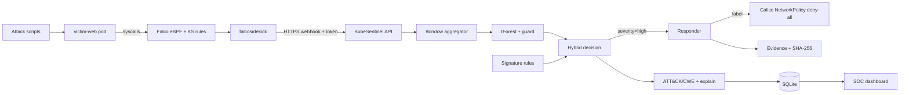

# Architecture

**Features (11):** exec count, unique procs, shells, connections, unique dst, unique ports, external connections,
sensitive reads, sensitive writes, Falco alert count, max priority.
**Design decisions:** tumbling windows (simple, deterministic); FPR-calibrated threshold (2% on training scores);
out-of-support guard (|z|≥8); response only on *high* severity; dry-run default; allow-listed namespaces.
